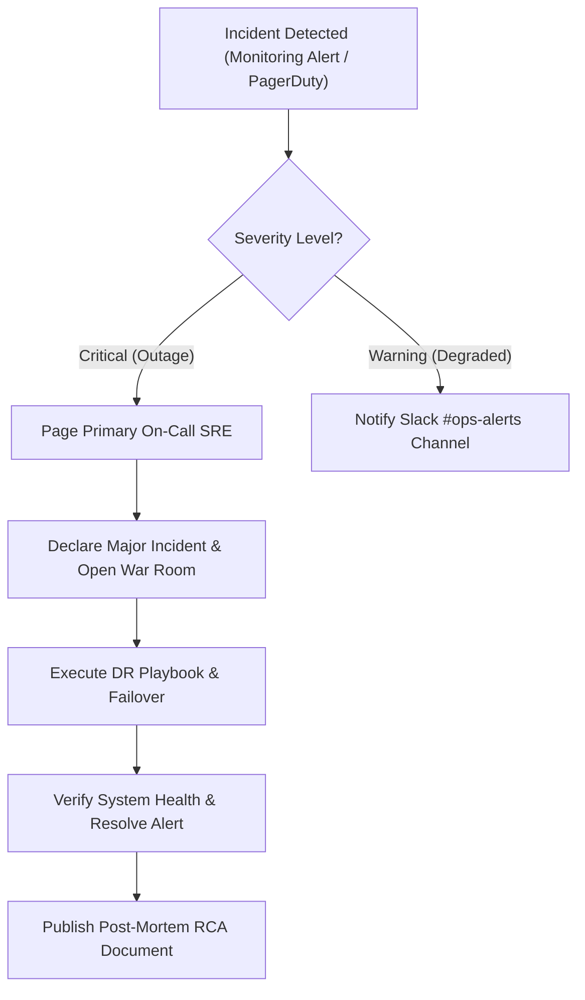

# NextHire AI - Enterprise Disaster Recovery (DR) Plan

This document details the Disaster Recovery strategy, Recovery Objectives, Restore Procedures, and Failover Workflows for NextHire AI.

---

## 1. Key Recovery Objectives

| Metric                             | Target SLA          | Strategy / Enforcement Mechanism                                                                      |
| :--------------------------------- | :------------------ | :---------------------------------------------------------------------------------------------------- |
| **Recovery Point Objective (RPO)** | **&lt; 5 Minutes**  | Continuous Write-Ahead Logging (WAL) streaming & PITR on Supabase Managed PostgreSQL.                 |
| **Recovery Time Objective (RTO)**  | **&lt; 15 Minutes** | Automated backup snapshot restore script (`scripts/backup-restore.js`) & Vercel DNS Instant Failover. |

---

## 2. Disaster Recovery Scenarios & Playbooks

### Scenario A: Primary Database Corruption or Data Loss

1. **Detection**: High error spike alert triggered in SRE Console or DB connectivity failure (`/api/metrics` returns HTTP 500).
2. **Execution Steps**:
   ```bash
   # 1. Trigger database PITR restore to 5 minutes prior to incident
   node scripts/backup-restore.js --restore nexthire_db_snapshot_daily_latest.sql.gz

   # 2. Execute migration validation script
   node scripts/migrate.js --validate

   # 3. Purge invalid query cache
   curl -X POST https://nexthire.ai/api/jobs/worker -H "Content-Type: application/json" -d '{"action":"purge_completed"}'
   ```
3. **Verification**: Pings `/api/health` and verifies DB connection pool state on `/admin/monitoring`.

---

### Scenario B: Primary Cloud Edge Provider (Vercel) Outage

1. **Detection**: Edge uptime checks detect 5xx gateway errors across global PoPs.
2. **Execution Steps**:
   - Update DNS Cloudflare A/AAAA records to point to Secondary Standby Docker Container cluster hosted on AWS ECS / GCP Cloud Run.
   - Verify health via `scripts/health-check.js`.

---

## 3. Incident Escalation & Response Workflow



---

## 4. Backup Retention & Integrity Verification

- **Daily Backups**: Retained for 30 Days.
- **Weekly Backups**: Retained for 52 Weeks.
- **Monthly Backups**: Retained for 7 Years.
- **Automated Verification**: `node scripts/verify-backups.js` executes daily via GitHub Actions to verify SHA-256 checksums and uncorrupted headers.
